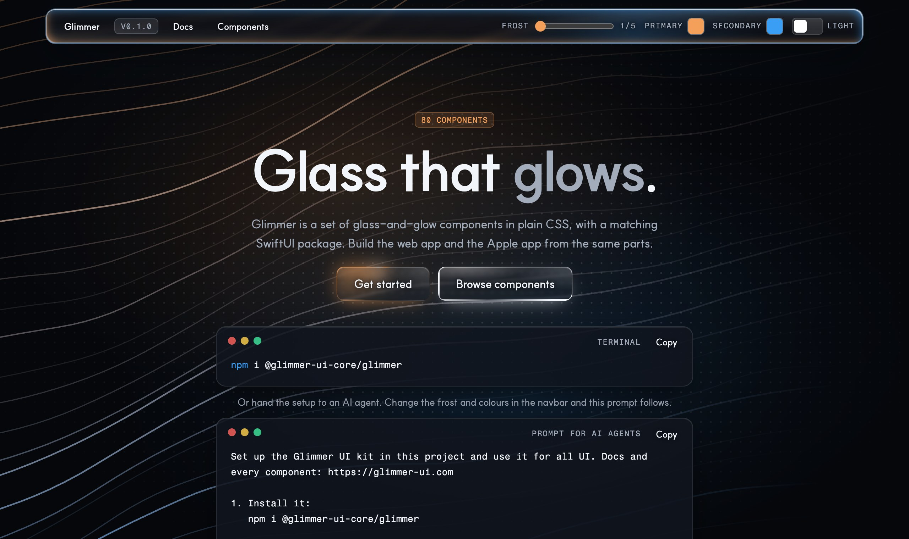
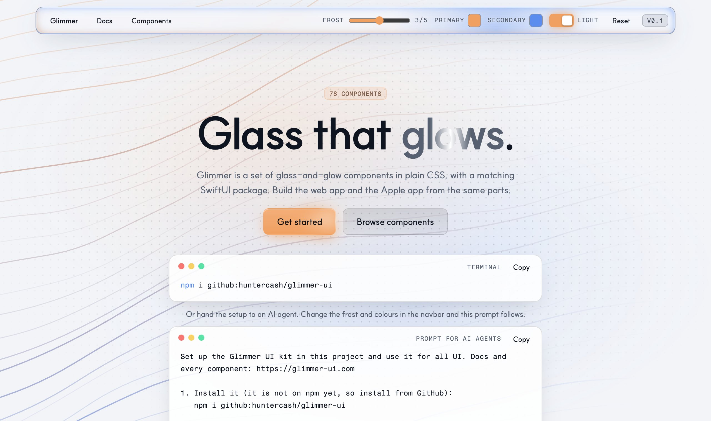
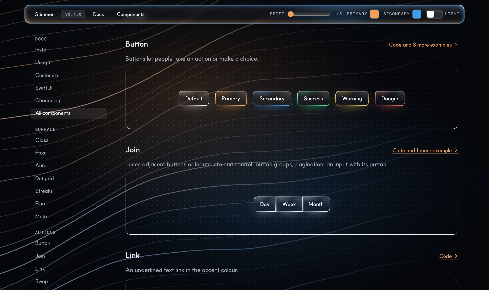

# Glimmer

[](https://glimmer-ui.com)
[](package.json)
[](LICENSE)
[](https://glimmer-ui.com/docs/install)
[](Package.swift)
[](https://sonarcloud.io/summary/new_code?id=huntercash_glimmer-ui)
[](https://sonarcloud.io/summary/new_code?id=huntercash_glimmer-ui)
[](https://sonarcloud.io/summary/new_code?id=huntercash_glimmer-ui)
[](https://github.com/huntercash/glimmer-ui/stargazers)
[](https://paypal.me/huntercash)

**Docs and live examples: [glimmer-ui.com](https://glimmer-ui.com)**



Glass-and-glow UI for the web and Apple platforms. One set of design tokens, two packages in one repository:

- **Web:** component classes in plain CSS, used like daisyUI (`btn btn-primary`). No build step. Works on its own or with Tailwind CSS v4.
- **Apple:** a SwiftUI package (`import Glimmer`) for iOS 17+ and macOS 14+.

78 components, including 15 chart types, a frost level you can turn from clear glass to milky, and light and dark themes.

> **Pre-release.** No stability promise yet, and only tested in Chromium so far. See [TODO.md](TODO.md) for what is open.

| Light theme, frosted glass | Every component, live |
| --- | --- |
|  |  |


## Install (web)

The package is `@glimmer-ui-core/glimmer`. (The unscoped `glimmer-ui` on npm is an unrelated package.)

```bash
npm i @glimmer-ui-core/glimmer
```

Then add it to your CSS:

```css
/* With Tailwind v4: utilities override components, and the tokens become bg-primary, text-muted, font-mono. */
@import "tailwindcss";
@import "@glimmer-ui-core/glimmer";
```

```css
/* Without Tailwind */
@import "@glimmer-ui-core/glimmer/css/index.css";
```

```html
<!-- Or straight from HTML -->
<link rel="stylesheet" href="node_modules/@glimmer-ui-core/glimmer/css/index.css">
```

```html
<button class="btn btn-primary">Hello, glass</button>
```

## How the classes work

1. **One class makes the component**, on the natural element: `btn`, `card`, `input`, `modal` (on `<dialog>`), `popover` (on an element with the `popover` attribute).
2. **Modifiers are named after it:** `btn-outline`, `btn-sm`, `avatar-lg`, `toast-top`.
3. **A suffix sets the colour:** `-primary`, `-secondary`, `-success`, `-warning`, `-danger`. For example `badge-success`.
4. **State comes from HTML attributes, not classes:** `disabled`, `open`, `aria-busy`, `aria-invalid`, `aria-selected`, `aria-current`, and `data-done` where HTML has no attribute.

Any element becomes a glass panel with `glass`. Add `glow` and its light follows the pointer.

```html
<article class="card glow">
  <p class="card-title">Night walk</p>
  <p>Shibuya after the rain.</p>
  <div class="card-actions">
    <button class="btn btn-ghost">Skip</button>
    <button class="btn btn-primary" aria-busy="true">Saving</button>
  </div>
</article>
```

Each component's markup is documented in the comment above its rule in `css/*.css`.

## Optional pieces

Everything below is opt-in. The default import is CSS only.

| Import | What it adds |
| --- | --- |
| `@glimmer-ui-core/glimmer/css/fonts.css` | The bundled SUIT and Fragment Mono fonts (about 790 kB). Without it, text uses the system font. |
| `@glimmer-ui-core/glimmer/css/tailwind.css` | Tailwind v4 only: variants on Glimmer's modifiers, such as `md:btn-lg` and `hover:btn-primary`. |
| `@glimmer-ui-core/glimmer/css/components.css` | Use instead of the default import to leave your page's background, font and focus styles alone. |
| `@glimmer-ui-core/glimmer/css/prefixed.css` | Use instead of the default import if names like `.btn` or `.card` are taken: every class gets a `gl-` prefix. |
| `@glimmer-ui-core/glimmer/glow.js` | Light follows the pointer on `.glow` surfaces. |
| `@glimmer-ui-core/glimmer/behaviors.js` | Tabs that switch panels (with arrow keys), `toast()`, carousel buttons, filtering a list as you type, tooltips screen readers can read. |
| `@glimmer-ui-core/glimmer/charts.js` | The chart functions and the `<gl-chart>` tag. |
| `@glimmer-ui-core/glimmer/react` | `Chart`, `Tabs`, `Modal`, `Drawer` and `toast`, with TypeScript types. |

The scripts are safe to import on a server, where they do nothing. Modals, drawers, popovers and accordions need no script: they are the native `<dialog>`, `[popover]` and `<details>`.

```js
import "@glimmer-ui-core/glimmer/glow.js";
import { toast } from "@glimmer-ui-core/glimmer/behaviors.js";

toast("Saved.", { type: "success" });
```

## Theming

Everything visual is a CSS variable.

```css
:root {
  --gl-primary: #e8b45a;
  --gl-secondary: #2f9aa0;
  --gl-font: "Inter", system-ui, sans-serif;
}
```

```html
<html class="frost-2" data-theme="auto">
```

- **Frost:** `frost-1` (clear glass) to `frost-5` (milky), on `<html>` or on one surface. The default is 3.
- **Light and dark:** dark by default. `data-theme="light"` for glass over a light page, `data-theme="auto"` to follow the system. It works on any element.
- **One-off colour:** every coloured component reads `--c`, so `<span class="badge" style="--c: #c58cff">` works.
- **Tokens:** colours, corner radii and durations live in [tokens.json](tokens.json) and are generated into both the CSS and the Swift package.

## Charts

Small dependency-free functions that return an SVG string, so they run on a server, in a build step or in the browser. They take their colours from the kit.

Line, area, bar, scatter, histogram, box plot, heatmap, pie and donut, sparkline, radar, chord diagram, candlestick, OHLC, RSI and MACD. The indicator maths (`sma`, `ema`, `bollinger`, `rsi`, `macd`, `heikinAshi`) is exported too.

```js
import { lineChart } from "@glimmer-ui-core/glimmer/charts.js";

element.innerHTML = lineChart(
  { labels: ["Mon", "Tue", "Wed"], series: [{ name: "Visits", values: [3, 5, 4] }] },
  { smooth: true },
);
```

In plain HTML, load the file as a module and use the tag. It draws at its own width, adds a crosshair with a readout, and with `zoom` lets people zoom and pan:

```html
<script type="module" src="node_modules/@glimmer-ui-core/glimmer/charts.js"></script>

<gl-chart type="candlestick" zoom data='{"candles":[{"date":"Oct 2","open":182,"high":186,"low":180,"close":185,"volume":64}]}'
  options='{"sma":[5,20],"bollinger":true}'></gl-chart>
```

Pass `times` (dates, ISO strings or millisecond numbers) instead of `labels` to a line or area chart for a real time axis.

## React

The classes go on plain elements, so most of Glimmer needs no components. The parts with behaviour have small ones:

```jsx
import { Chart, Tabs, Modal, toast } from "@glimmer-ui-core/glimmer/react";

<button className="btn btn-primary" onClick={() => toast("Saved.", { type: "success" })}>Save</button>

<Chart type="line" data={{ labels, series }} options={{ smooth: true }} />

<Tabs tabs={[{ label: "Overview", content: <Overview /> }, { label: "Activity", content: <Activity /> }]} />

<Modal open={open} onClose={() => setOpen(false)}>
  <p className="card-title">Delete album?</p>
</Modal>
```

`Chart` is drawn on the server and becomes interactive in the browser.

## Components

| Group | Components |
| --- | --- |
| Surface | Glass, Frost, Aura, Dot grid, Streaks, Flare, Meta |
| Actions | Button, Join, Link, Swap |
| Data input | Text input, Field, Fieldset, Textarea, Select, Checkbox, Radio, Toggle, Range, File input, Search, Rating, Kbd |
| Data display | Card, Badge, Status, Avatar, Stat, Table, List, Timeline, Accordion, Chat bubble, Divider, Indicator, Stack, Carousel |
| Feedback | Alert, Toast, Tooltip, Progress, Radial progress, Spinner, Orb, Shimmer, Skeleton |
| Charts | Line, Area, Bar, Scatter, Histogram, Box plot, Heatmap, Pie and donut, Sparkline, Radar, Candlestick, OHLC, RSI, MACD, Chord diagram |
| Navigation | Navbar, Tabs, Breadcrumbs, Menu, Steps, Dock, Pagination |
| Overlay | Modal, Drawer, Popover |
| Layout | Hero, Footer |
| Mockup | Code, Window, Phone |

To browse them all with live examples and copyable code, run the docs site (below), or open `demo/index.html` through any static server.

## SwiftUI

In Xcode, choose File → Add Package Dependencies and enter `https://github.com/huntercash/glimmer-ui`. Or in a package manifest (there is no tagged release yet, so track `main`):

```swift
dependencies: [
    .package(url: "https://github.com/huntercash/glimmer-ui", branch: "main"),
],
targets: [
    .target(name: "App", dependencies: [.product(name: "Glimmer", package: "glimmer-ui")]),
]
```

```swift
import Glimmer

VStack(spacing: 16) {
    SearchField(text: $query)
    Stat("Revenue", value: "$48,210", caption: "↑ 12% vs last month")
    Button("Save") {}.buttonStyle(.glimmer(.primary))
}
.padding()
.background(DotGrid())
.glimmerTheme()      // once, at the root: scheme, colours, fonts, accent
.glimmerFrost(2)     // 1 clear … 5 milky
```

It includes `.glass()` for any view, button and card styles, `SearchField`, `MenuRow`, `Badge`, `StatusDot`, `Avatar`, `Banner`, `Stat`, `Bubble`, `Orb`, `Flare`, a theme for Swift Charts (`.glimmerChartStyle()`), and `StockChart`, `RSIChart`, `MACDChart`, `RadarChart` and `ChordDiagram`. Toggle, Slider, Picker, sheets and the other system controls stay native; the theme tints them. Put `GlimmerGallery()` in an Xcode preview to see everything.

## Accessibility and platform support

- Components follow the page's direction, so `dir="rtl"` mirrors them.
- Animations stop for people who ask for reduced motion. More contrast and less transparency make the glass more solid. Windows high-contrast mode keeps every state visible. Pages print in the light theme without glows.
- Chart crosshairs work from the keyboard, and rising and falling candles differ by shape as well as colour.
- **Browsers:** built on recent CSS (cascade layers, `color-mix`, relative colours, anchor positioning, `@property`). Tested in Chromium only so far; Safari and Firefox are on the to-do list. Print and high-contrast rules are written but not yet verified.

## Working on Glimmer

```
tokens.json          the source of truth for colours, radii and durations
css/                 the components; tokens.css, colors.css, prefixed.css and tailwind.css are generated
charts.js            chart functions and <gl-chart>
behaviors.js         tabs, toast, carousel, filtering, tooltips
react.js             React components
Sources/ Tests/      the SwiftUI package
demo/                a plain-HTML gallery
site/                the docs site (Next.js)
```

```bash
npm run build        # regenerate the CSS and Swift tokens after changing tokens.json or css/
npm test             # chart maths and the generated CSS
swift test           # the SwiftUI package
```

```bash
cd site && npm install && npm run dev    # the docs site
cd site && npm run check                 # every class the docs use exists in the CSS
```

## Licence

[MIT](LICENSE). The bundled fonts, SUIT and Fragment Mono, are under the SIL Open Font License; see the files in [fonts/](fonts).
